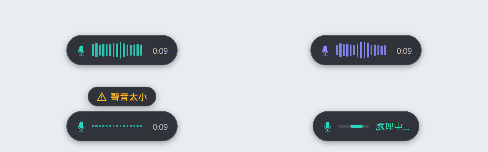
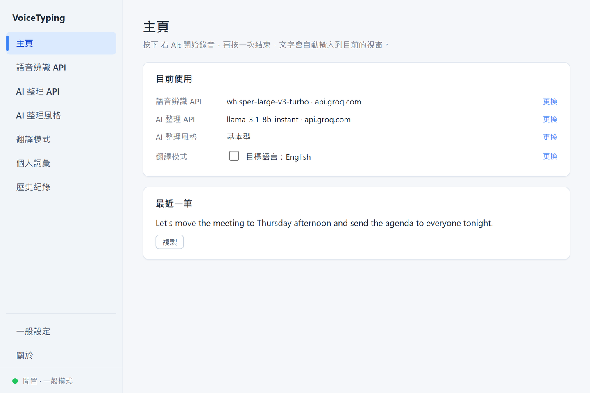
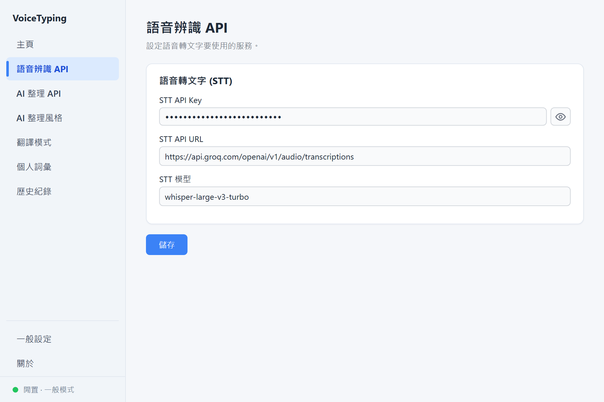
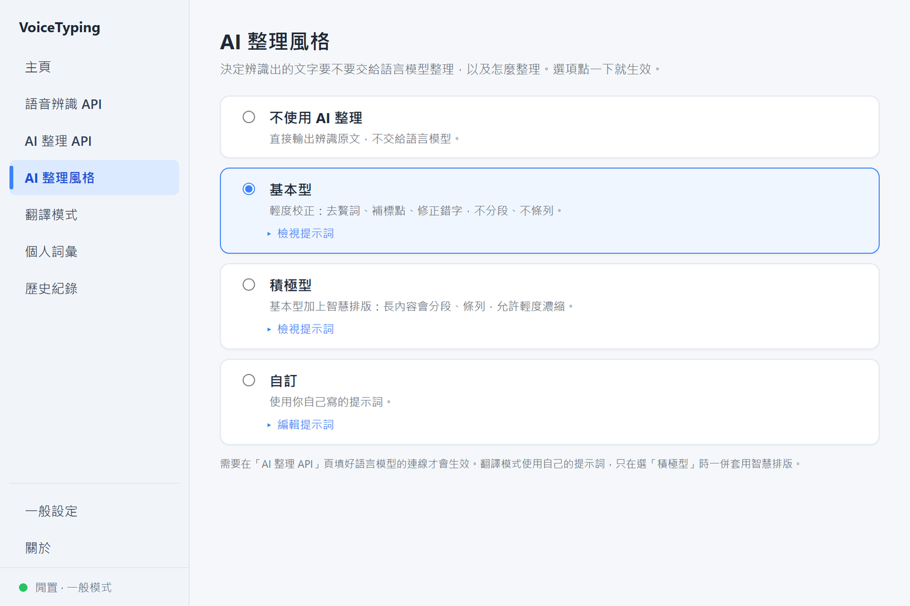
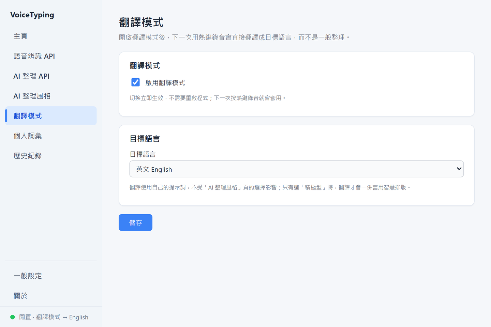
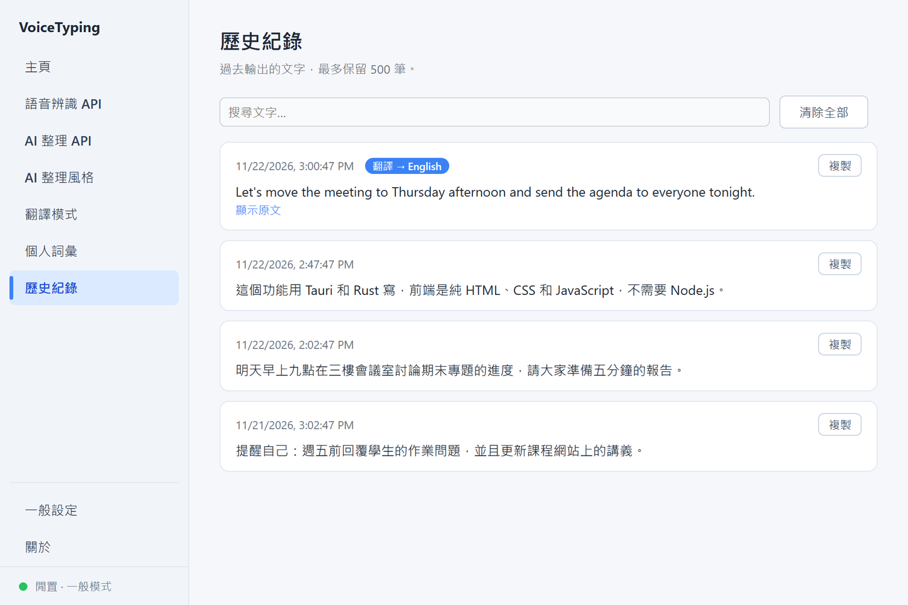

# VoiceTyping

[繁體中文](./README.md) | **English**

VoiceTyping is a small Windows desktop tool that lets you type with your voice in any app.

Press a hotkey to start recording, press it again to stop. The tool sends the audio to a speech-to-text service (Groq Whisper by default), lets a language model do a light clean-up of the text (Groq LLM by default), and then types the result into the input box that has focus.

You can also turn on **translation mode** in the settings. When it is on, the next recording is translated into a target language that you choose, instead of only being cleaned up.

The tool runs in the Windows system tray (the notification area at the bottom-right of the taskbar). The full specification (in Chinese) is in [`voicetyping-spec.md`](./voicetyping-spec.md).



*While you record, a capsule appears at the bottom of the screen. Top left: recording in normal mode. Top right: recording in translation mode. Bottom left: the "volume too low" warning. Bottom right: processing after you stop.*

> The user interface is currently in Traditional Chinese only. The screenshots below have English captions that explain each screen.



*Home page of the main window. It shows the services and style in use, a translation mode switch, and the latest result.*

## Download and install

Download the latest `VoiceTyping_<version>_x64-setup.exe` from [Releases](https://github.com/dr-chenglung/voice-typing/releases) and run it. You can also build the tool from source (see [Build and run](#build-and-run)).

> **About the Windows SmartScreen warning**: the installer is **not code-signed** (a signing certificate has a yearly fee). Because of this, Windows shows a blue "Windows protected your PC" warning the first time you run it. This warning means "this publisher has no certificate". It does not mean that malware was found. To continue, click **"More info"** and then **"Run anyway"**. If you do not want to do this, build the tool from source instead.

## Requirements

- Windows 10 or 11, with the WebView2 Runtime. Most Windows 10/11 systems already have it. If it is missing, install the [Evergreen Runtime](https://developer.microsoft.com/microsoft-edge/webview2/).
- Rust (stable, MSVC toolchain). Only needed if you build from source.
- Tauri CLI: `cargo install tauri-cli` (install once; Node.js and npm are not needed). Only needed if you build from source.
- An API key for speech-to-text and for the language model. The defaults use Groq, so one Groq API key (<https://console.groq.com>) is enough.

## Settings

You enter API keys only in the **settings window**. Right-click the tray icon, choose **"Open VoiceTyping"**, and fill in the API keys and other options on pages such as "Speech recognition API" and "AI clean-up API". Saved settings take effect right away. The only exception is the hotkey: after you change it, you must restart the program. Environment variables are not supported.



*The "Speech recognition API" page. The API key is hidden with dots by default; click the eye button to show it. The "AI clean-up API" page has the same three fields for the LLM.*

**Settings are stored in `%APPDATA%\com.clhuang.voicetyping\config.toml`.** The settings window creates and writes this file when you save, so you do not need to prepare it by hand. If this file does not exist, the program also reads a `config.toml` next to the executable or in the current working directory (for older versions).

Speech-to-text (STT) and the clean-up language model (LLM) are **configured separately**. Both use Groq by default, and both can point to any other OpenAI-compatible provider (for example, the official OpenAI API). To change the provider, change the URL, key and model in the settings window. No code change is needed.

| Field | Meaning | Default |
|-------|---------|---------|
| `stt_api_key` | API key for STT | (empty, you must fill it in) |
| `stt_api_url` | STT endpoint URL | `https://api.groq.com/openai/v1/audio/transcriptions` |
| `stt_model` | Speech-to-text model | `whisper-large-v3-turbo` |
| `llm_api_key` | API key for the clean-up LLM | (empty, you must fill it in) |
| `llm_api_url` | LLM endpoint URL | `https://api.groq.com/openai/v1/chat/completions` |
| `llm_model` | Clean-up model | `llama-3.1-8b-instant` |
| `enable_correction` | Whether the LLM cleans up the text | `true` |
| `hotkey` | Hotkey that starts and stops recording; can be `right_ctrl` | `right_alt` |
| `target_language` | Target language for translation mode, written as an English language name | `English` |
| `translate_mode_active` | Whether translation mode is on. It is read when a recording starts, so no restart is needed | `false` |

The language of your speech is always **detected automatically**. You do not need to set it. Outside translation mode, the output stays in the language you spoke.

## Build and run

```powershell
cargo install tauri-cli   # install once
cd src-tauri
cargo tauri dev           # development mode
cargo tauri build         # build the release installer (NSIS) and a standalone exe
```

## How to use

1. After start-up, the program stays in the system tray (a white microphone on a blue square).
2. Click into any input box (Notepad, a browser, and so on).
3. Press **Right Alt**. You hear a short start sound, and a **recording capsule** appears at the bottom center of the screen. It shows a waveform that moves with your voice and the recording time. Speak, then press **Right Alt** again to stop.
4. The capsule shows "Processing…". After a few seconds, the cleaned-up text is typed at the cursor. If the whole recording has no speech, the program skips it and does not send it for recognition.
5. Right-click the tray icon to open the menu:
   - **Open VoiceTyping**: opens the main window. Use the left sidebar to switch pages: Home (setup reminders, current settings, translation mode switch, latest result), Speech recognition API, AI clean-up API, AI clean-up style, Translation mode, Personal vocabulary, History, General settings (hotkey, settings file location) and About.
   - **History**: opens the main window on the History page. You can browse past results (saved on disk), search them, and copy any item. Translated items show the target language and the original text. You can also clear all history with one click.
   - **Quit**: exits the program.

> The recording capsule never takes keyboard focus and lets mouse clicks pass through it, so it does not disturb the window you are typing in. If no speech is heard for a while during recording, a small message appears above the capsule: "volume too low" or "no sound received".

The tray icon looks the same in every state. To see the current state (idle, recording, processing), move the mouse over the icon and read the tooltip. When an error happens, the tooltip shows it, and a Windows notification explains the reason.

### AI clean-up style

On the "AI clean-up style" page you choose one of four options:

| Option | What it does |
|--------|--------------|
| No AI clean-up | Outputs the speech-to-text result as it is. |
| Basic | Light clean-up: removes filler words, adds punctuation, and fixes words that were heard wrong (for example, an English technical term that was written as Chinese sounds). It does not change the meaning or rewrite the text. |
| Active | Everything in Basic, plus layout: long text is split into paragraphs or bullet points and lightly shortened, without losing or adding information. |
| Custom | You write the whole system prompt yourself. |



*The "AI clean-up style" page. From top to bottom: No AI clean-up, Basic, Active, Custom.*

You can open and read the built-in prompts on that page. If you list your common terms on the "Personal vocabulary" page, they are sent to both the speech-to-text service and the LLM to help them spell these terms correctly.

### Translation mode

Turn on **Enable translation mode** in the settings window. The hotkey and the way you record stay exactly the same. The only difference is that, after you stop recording, the output is translated into the **target language** set in the settings window (English by default), instead of only being cleaned up. The switch takes effect as soon as you save, and **no restart is needed**. It only affects the *next* recording; a recording that is already running or being processed is not changed.

The recording capsule uses color to show the current mode: **teal = normal mode, blue-violet = translation mode**. When the program is idle, the tray tooltip also shows the mode, for example "Transcription mode" or "Translation mode → English".



*The "Translation mode" page: a switch to turn translation on, and a list to choose the target language (you can also type your own).*

### History



*The "History" page. The first item was translated into English; click "show original" (顯示原文) to see what you said. Each item has a copy button, and the button at the top right clears all history.*

## Error handling

- If recording or speech-to-text fails, the program shows a Windows notification and goes back to idle.
- If the LLM clean-up or translation fails (or no LLM API key is set), the program shows a notification and types the raw speech-to-text result instead. Your words are not lost.
- Speech-to-text requests time out after 30 seconds, and LLM requests time out after 20 seconds, so the program never waits forever.

## Module structure

Backend (`src-tauri/src/`):

| File | Role |
|------|------|
| `main.rs` | Entry point, thread wiring, Tauri event loop |
| `config.rs` | Read and save settings (`app_config_dir()` is the main location; older locations are still read) |
| `commands.rs` | IPC commands for the main window (settings, history, settings file path) |
| `status.rs` | Keeps the current state (idle / recording / processing) and sends it to the main window |
| `hotkey.rs` | Listens for the single toggle hotkey with `rdev` |
| `audio.rs` | Records with `cpal`, resamples to 16 kHz mono, packs WAV in memory with `hound`, detects silence |
| `state.rs` | `AppState` and `OutputMode` (normal / translation, decided when a recording starts) |
| `transcribe.rs` | Speech-to-text, LLM clean-up and translation |
| `controller.rs` | State machine, processing pipeline (clean-up or translation), fallback when something fails |
| `typer.rs` | Outputs text by pasting from the clipboard (Ctrl+V), which avoids problems with Chinese input methods; falls back to typing with `enigo` |
| `tray.rs` | Tray icon, tooltip, menu (Open VoiceTyping / History / Quit), opens the main window |
| `overlay.rs` | Life cycle of the recording capsule window (show / hide / position / no-activate / mode color) and live volume updates |
| `history.rs` | Reads and writes text history (`app_data_dir()/history.json`, including translation fields) |
| `notify.rs` | Shows Windows notifications when a background task fails |
| `sound.rs` | Start and stop sounds (sound files are embedded in the program) |

Frontend (plain static HTML/CSS/JS with no build step, in `ui/`):

| Folder | Role |
|--------|------|
| `ui/overlay/` | Recording capsule: microphone icon, waveform bars, recording time and volume warnings (pure logic in `lib/`, tested with `node --test`) |
| `ui/app/` | Main window: a left sidebar switches pages, one module per page (`pages/`), pure logic in `lib/` (tested with `node --test`) |

Run the frontend tests with:

```powershell
node --test "tests/ui/*.test.js"
```

## Privacy

- Recorded audio stays **only in memory**. It is never written to disk and is dropped after use.
- History keeps **only the text** results (up to 500 items; when there are more, the oldest ones are removed first).
- API keys are stored in plain text in `config.toml` under `%APPDATA%`. The settings window hides them with dots by default, so they are not shown when you share your screen.

## Known limitations

- Windows only.
- One recording can be about 12 minutes at most (25 MB). Longer recordings cause an error.
- On some European keyboard layouts, Right Alt works as AltGr. If this affects you, use `hotkey = "right_ctrl"`.
- The hotkey can only be **Right Alt** or **Right Ctrl**.
- After you change the hotkey, you must restart the program (`rdev::listen` has no clean way to stop). The translation mode switch does **not** need a restart.
- Output uses the clipboard, so the clipboard is used for a short moment while text is pasted. Text in the clipboard is restored afterwards; non-text content (such as an image) is not restored.
- Silence detection looks at changes in volume. It cannot tell a human voice from music or TV sound, so with music in the background, silent recordings may still be sent for recognition.
- Very short recordings (stopped within about 0.7 seconds) are skipped, because the start sound can be picked up by the microphone.
